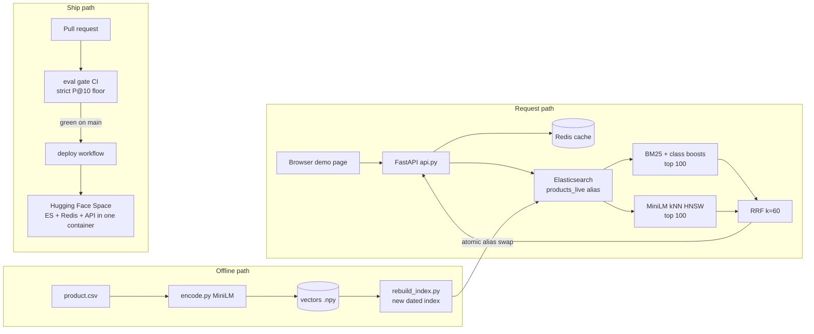

# WANDS semantic search

A production-style product search system built end to end on [Wayfair's public
WANDS dataset](https://github.com/wayfair/WANDS): 42,994 furniture products,
480 evaluation queries, 233,448 human relevance labels. Keyword search (BM25)
and semantic search (MiniLM vectors) run side by side in Elasticsearch and are
fused with hand-written Reciprocal Rank Fusion, behind a FastAPI service with
a Redis cache, an eval gate in CI, and a one-container public demo.

**Live demo:** https://huggingface.co/spaces/rosie95/wands-search
(the free tier sleeps when idle and rebuilds its index on wake, so the first
visit after a sleep is slow; the measured cold start time is in
[`results/perf.csv`](results/perf.csv)).

Every number in this README comes from a logged run in
[`results/runs.csv`](results/runs.csv) or a measurement in
[`results/perf.csv`](results/perf.csv). Each design choice has its evidence in
[`DECISIONS.md`](DECISIONS.md), the raw experiment outputs are in
[`docs/experiments.md`](docs/experiments.md), and everything that broke along
the way is in [`PROGRESS.md`](PROGRESS.md).

## Results

Precision@10 on all 480 WANDS queries. Strict counts only Exact labels as
relevant; lenient counts Exact and Partial. Unlabelled share is the fraction
of returned products no annotator ever saw for that query (a trust warning,
not a score). The strict ceiling, with labels as they are, is 0.5975.

| System | Strict P@10 | Lenient P@10 | Unlabelled |
|---|---|---|---|
| Plain BM25 (the floor) | 0.3229 | 0.6892 | 0.2554 |
| BM25 + class-boost rewriting (keyword baseline) | 0.3208 | 0.7140 | 0.2354 |
| MiniLM vectors, HNSW | 0.3475 | 0.7758 | 0.1919 |
| **Hybrid: RRF over both (deployed)** | **0.3688** | **0.8069** | **0.1598** |
| Best possible (label ceiling) | 0.5975 | 0.9858 | 0.0 |

Winners were decided with a paired bootstrap over queries (10,000 resamples);
a change only counts if its 95% interval excludes zero. Ties go to the simpler
option.

## Six results worth reading

**1. Fine-tuning made search worse, in proportion to how well it trained.**
The only training signal available without touching the eval labels was the
product category tree. All three fine-tunes (LoRA rank 4 and 16, full) learned
it well, and every one damaged retrieval, monotonically with capacity:

| Encoder | Strict P@10 | Training eval loss |
|---|---|---|
| MiniLM, untuned (kept) | 0.3475 | - |
| LoRA rank 4 | 0.2738 | 0.0257 |
| LoRA rank 16 | 0.1727 | 0.0154 |
| Full fine-tune | 0.1087 | 0.0035 |

The objective ("same category means similar vectors") erases exactly what
short queries need: brand and collection names, cross-category styles, sizes.
For the query "delta trinsic", the untuned model returns Trinsic-collection
fixtures; the tuned one returns marble coasters. Lesson: product-to-product
similarity from a taxonomy is the wrong signal for query-to-product retrieval.
Details and the worst-20 query analysis: `docs/experiments.md`, item 8.

**2. A product is not the average of its features.** Pooling per-feature
vectors (mean, max, top-3 centroid) scored 0.05 to 0.07 strict P@10 against
0.3475 for encoding the product text as one passage.

**3. The cache is what makes 50 requests per second possible.** One CPU
worker saturates at 24 req/s uncached (p50 1.2 s); with a 64 MB Redis LRU it
holds 44 req/s at p50 6 ms with a 93.6% hit rate on repeating traffic.

**4. Never rebuild the index clients are reading.** Rebuilding in place under
load produced 30 failed or empty responses and a 139-second window of silently
incomplete results. Building beside and moving the `products_live` alias in
one atomic step produced zero failures on the same load.

**5. The eval gate catches real regressions.** CI rebuilds the stack from
scratch and re-measures the deployed method on every PR. It passed its own PR
at strict 0.3675 and failed a deliberately broken one at 0.3219
([the evidence PR](https://github.com/SimardeepKaur/wands-semantic-search/pull/16),
kept closed).

**6. One replica is an outage; three are a non-event.** On Kubernetes (kind),
killing the only API pod under load failed 70 of 536 requests while the pod
was rebuilt; killing one of three failed none of 836. The same cluster held
45.6 req/s warm (p50 4 ms), and the experiment surfaced a real bug: the API
connected to its cache once at startup, Redis came up 24 minutes later, and
every pod silently ran cacheless until the connection became a lazy retry.

## Architecture



The service always queries the `products_live` alias, never an index name.
Queries are encoded on CPU at request time; identical requests come from
Redis. Logs are one JSON line per request; `src/log_summary.py` turns them
into zero-result rate, latency percentiles and the slowest queries.

## Run it from a fresh clone

Needs Docker and Python 3.11.

```bash
git clone https://github.com/SimardeepKaur/wands-semantic-search.git
cd wands-semantic-search

# data: the public WANDS dataset and the stored vectors
git clone --depth 1 https://github.com/wayfair/WANDS.git data/WANDS
mkdir -p data/vectors
curl -fsSL -o data/vectors/products_minilm.npy \
  https://github.com/SimardeepKaur/wands-semantic-search/releases/download/data-v1/products_minilm.npy
curl -fsSL -o data/vectors/product_ids_minilm.npy \
  https://github.com/SimardeepKaur/wands-semantic-search/releases/download/data-v1/product_ids_minilm.npy

# services and environment
docker compose up -d
python3.11 -m venv .venv && .venv/bin/pip install -r requirements.txt

# index the products and point the alias at the new index
PYTHONPATH=src .venv/bin/python src/rebuild_index.py --model minilm

# demo labels for the page (optional), then the service
.venv/bin/python eval/export_demo_labels.py
.venv/bin/uvicorn api:app --app-dir src --port 8000
```

Open http://localhost:8000 and search. To re-measure any number:

```bash
.venv/bin/python eval/run_eval.py --method hybrid_rrf60 --run-name my_check --no-log
.venv/bin/python tests/test_api.py
```

## Repo map

```
src/        search, patching, RRF, encoding, indexing, alias swap, API, logs
eval/       scorer and logger, paired bootstrap, leakage check, CI gate
loadtest/   Locust file and the rebuild/cache/zero-result experiments
deploy/hf/  the one-container Space image and its assembly
k8s/        Kubernetes manifests, run locally on kind
results/    runs.csv (every eval), perf.csv (every measurement), load CSVs
docs/       problem statement, raw experiment outputs
```

Built on an 8 GB MacBook (CPU encoding, Colab T4 for training) with a fixed
stack chosen up front; where a measurement contradicted the stack, the number
won and the change is recorded in `DECISIONS.md`.
